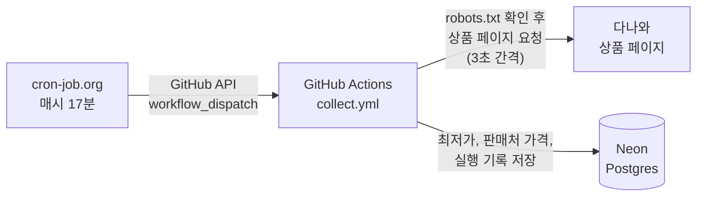

# FlowDeck

반복되는 데이터 수집과 모니터링을 자동으로 돌리고, 결과를 관리하는 포털을 만드는 프로젝트.

첫 시나리오는 온라인 셀러를 위한 경쟁사 가격 모니터링이다. 상품 가격을 주기적으로 모으고, 쌓인 데이터로 가격 변동을 분석하는 것까지가 목표다.

결과물만큼 개발 과정을 남기는 데 무게를 두고 있다. 무엇을 왜 그렇게 정했고, 어디서 막혀서 어떻게 풀었는지는 [docs/](docs/README.md)에 있다.

## 지금 동작하는 것

- 다나와 상품 20개의 가격을 1시간마다 수집해서 Postgres(Neon)에 쌓는다.
  - 상품마다 최저가, 판매처 수, 상위 판매처(페이지에 나오는 만큼, 지금까지 본 최대는 10곳)의 판매처 이름·가격·배송비
  - 실행마다 성공·실패 여부와 실패 원인을 기록한다.
- 수집 대상은 [backend/targets/danawa.txt](backend/targets/danawa.txt) 파일로 관리한다. 파일을 고쳐서 main에 합치면 다음 수집부터 반영된다.
- push와 PR마다 린트와 테스트가 돈다. DB 테스트는 실제 Postgres에서 돈다.

## 아직 없는 것

- 포털 화면과 API (작업 목록, 실행 이력, 데이터 조회, 수동 실행, 알림 설정)
- 가격 분석 (급락 감지, 할인 패턴 등). 데이터가 몇 주 쌓인 뒤 시작한다.
- 공개 데모용 연습 쇼핑몰. 다나와에서 모은 데이터는 공개하지 않는다.

## 수집 흐름



처음에는 GitHub Actions 예약 실행(schedule)을 쓰려고 했는데, 이 저장소에서는 예약 실행이 한 번도 돌지 않았다. 그래서 외부 cron 서비스가 GitHub API로 워크플로를 실행하게 바꿨다 ([TS-0003](docs/troubleshooting/0003-scheduled-workflow-not-running.md), [ADR-0006](docs/adr/0006-external-cron-trigger.md)).

## 수집 원칙

다나와 이용약관과 robots.txt를 확인하고, 법적 위험을 줄이는 쪽으로 정했다. 법률 검토를 받은 것은 아니다. 자세한 근거는 [ADR-0004](docs/adr/0004-real-data-source-alternatives.md).

- 소수 상품만, 1시간에 한 번, 요청 사이 3초 간격
- robots.txt가 막은 경로는 요청하지 않는다. 판매처 전체 목록이 그런 경로라서 처음 받는 페이지에 있는 상위 판매처만 쓴다.
- 브라우저로 위장하지 않고 수집기 이름을 밝힌 User-Agent를 쓴다.
- 403, 429 같은 차단 응답을 받으면 우회하지 않고 멈춘다.
- 가격, 판매처, 시각만 저장한다. 이미지, 상품 설명, 리뷰는 저장하지 않는다.

## 기술 스택

| 영역 | 사용 | 근거 |
|---|---|---|
| 백엔드 | Python 3.13 | [ADR-0001](docs/adr/0001-tech-stack.md) |
| 패키지 관리 | uv | 다른 도구와 비교하지 않고 골랐다 ([일지 10-23](docs/devlog/2026-10-23.md)) |
| 수집 | httpx, selectolax | httpx는 ADR-0001에서 정했다. selectolax는 비교 없이 골랐다 ([일지 10-24](docs/devlog/2026-10-24.md)) |
| DB | PostgreSQL 17, SQLAlchemy, Alembic | [ADR-0001](docs/adr/0001-tech-stack.md), [ADR-0005](docs/adr/0005-collector-data-model.md) |
| 실행 | GitHub Actions, Neon, cron-job.org | [ADR-0003](docs/adr/0003-collector-runtime.md), [ADR-0006](docs/adr/0006-external-cron-trigger.md) |
| 웹 (예정) | Next.js, TypeScript | [ADR-0001](docs/adr/0001-tech-stack.md) |

## 저장소 구조

```
backend/     수집기, DB 모델, 마이그레이션, CLI
  targets/   수집 대상 상품 목록
docs/        개발 기록 (ADR, 트러블슈팅, 일지, 분석 노트)
infra/       로컬 Postgres 초기화 SQL
.github/     CI, 수집 워크플로
compose.yaml 로컬 개발용 Postgres
```

## 로컬에서 실행

[backend/README.md](backend/README.md)를 본다. Docker로 Postgres를 띄우고 `uv run flowdeck collect`로 한 번 수집할 수 있다.

## 개발 기록

전체 목록은 [docs/README.md](docs/README.md).

- 기술 결정 (ADR): 대안을 비교하고 고른 기록. 처음 고른 데이터 소스(네이버 쇼핑 검색 API)가 이미 종료돼 있어서 폐기한 기록([ADR-0002](docs/adr/0002-real-data-source.md))도 남겨 두었다.
- 트러블슈팅: 첫 가설이 틀렸거나 원인이 예상과 달랐던 문제. 증상, 확인한 가설, 원인, 해결, 배운 것 순서로 쓴다.
- 개발 일지: 날짜별로 한 일, 판단과 근거, 문제, 배운 것.

작업 규칙(커밋, 브랜치, PR)은 [docs/conventions.md](docs/conventions.md), 기록을 쓰는 원칙은 [docs/record-principles.md](docs/record-principles.md).
