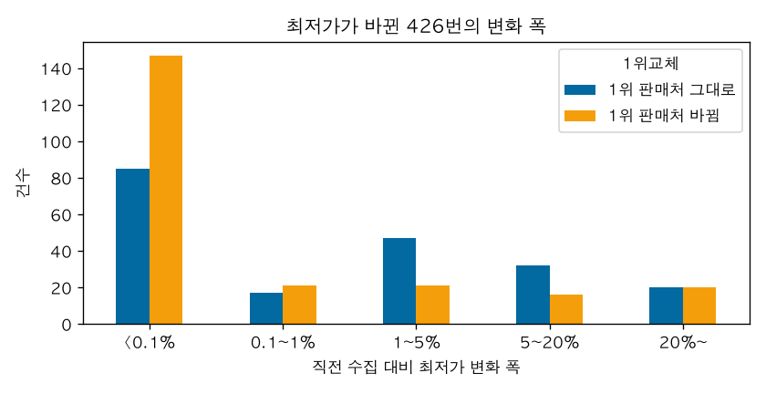
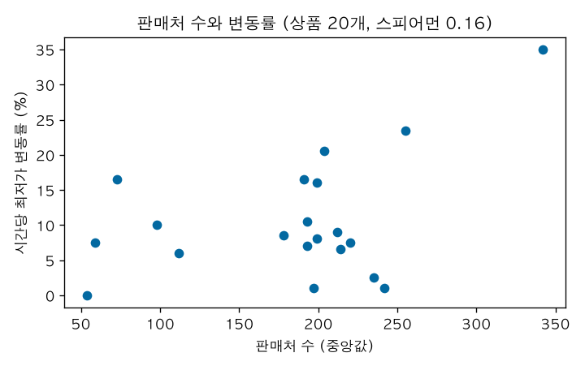
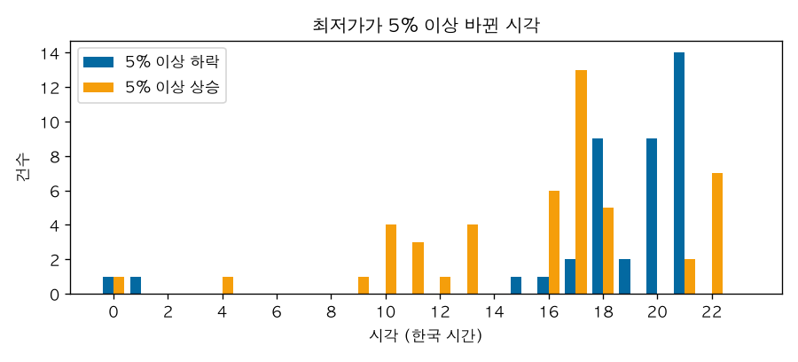
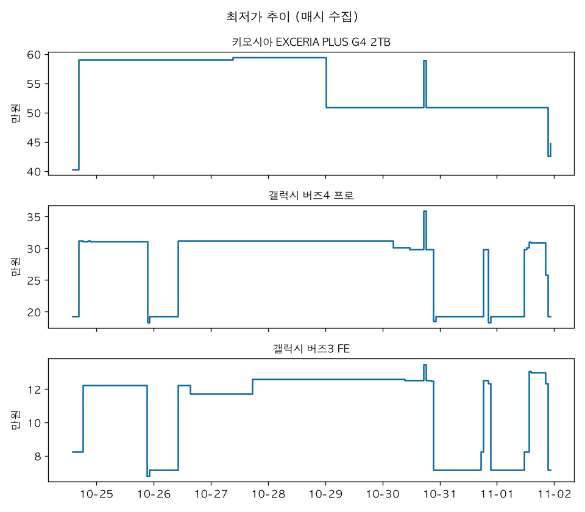

# AN-0001: 다나와에서 1주 모은 가격은 어떻게 움직이나

- 날짜: 2026-11-01
- 데이터: Neon 수집 DB, 다나와 상품 20개, 2026-10-24 13:54 ~ 11-01 22:19 (한국 시간). 실행 202회, 상품별 결과 4,040건, 판매처 가격 40,070행
- 코드: `analysis/export.py`, `analysis/an0001.py`
- 상태: 결론

## 질문

- 수집이 매시 고르게 됐나. 빠진 시간대가 있나.
- 상품별 최저가는 얼마나 자주, 얼마나 크게 바뀌나.
- 최저가 1위 판매처는 얼마나 바뀌나.
- 상품을 고를 때 "판매처가 많으면 가격이 자주 움직일 것"이라고 봤다. 맞나.
- 그래서 어떤 분석 기능을 만들고 어떤 건 만들지 않나 (devlog 2026-10-23의 후보: 급락 감지, 요일·시간대 할인 패턴, 가격 순위, 품절).

## 데이터

- `export.py`로 실행, 상품별 결과, 판매처 가격 세 테이블을 받았다. 받은 원본은 커밋하지 않는다 (ADR-0004 수집 원칙 6).
- 최저가는 페이지 JSON-LD의 `lowPrice`다. 변동은 정상(ok) 결과끼리 같은 상품의 바로 앞 결과와 비교했다. 실패 33건은 비교에서 빠진다.
- 판매처 이름은 쇼핑몰 단위다(로고의 이름). G마켓, 옥션, 11번가 같은 오픈마켓은 그 안의 여러 개별 판매자가 같은 이름으로 묶인다.
- 배송비는 이번 분석에 쓰지 않았다. 파서 버그로 빠른배송 판매처의 배송비가 잘못 저장돼 있다 (아래 시도 8, #33).

## 시도

### 1. 수집 간격

- 정기 실행 199회, 간격 중앙값 60.0분, 최대 60.4분이다. 한 시간이 통째로 빠진 곳은 없다.
- 시작 분은 198회가 17분, 1회가 36분이었다 (그 다음 실행까지 41.5분).
- 실행 시간은 중앙값 81초다. 최대 423초는 아래 10-26 04시 실패 때다.

### 2. 실패

| 시각 | 상태 | 건수 | 메시지 |
|---|---|---|---|
| 10-26 04시 | http_error | 20 | `ConnectTimeout('timed out')` |
| 10-28 08시 | http_error | 1 | `RemoteProtocolError('Server disconnected without sending a response.')` |
| 10-30 16시 | parse_failed | 10 | `Product 타입 JSON-LD를 찾지 못함` |
| 10-30 17시 | parse_failed | 2 | 같음 |

- 10-26 04시는 20개 모두 연결 시간 초과다. 상품마다 20초씩 기다려서 실행이 7분 걸렸다. 다나와 쪽 문제로 보이지만 원인은 확인하지 못했다.
- 10-30 16시는 HTTP 200인데 JSON-LD가 없었다. 18시부터 다시 정상이다. 실패한 페이지 HTML을 저장하지 않아서 그때 페이지가 어떻게 생겼는지는 알 수 없다.

### 3. 최저가 변동 빈도와 폭

- 연속 수집 쌍 3,987개 중 최저가가 바뀐 쌍은 426개(10.7%)다.
- 바뀐 금액의 중앙값은 110원이다. 25%는 10원이다. 75% 분위는 12,495원, 90% 분위는 70,085원이다. 아주 작은 변화와 아주 큰 변화가 섞여 있다.

| 변화 폭 | 1위 판매처 그대로 | 1위 판매처 바뀜 | 합계 |
|---|---|---|---|
| 0.1% 미만 | 85 | 147 | 232 |
| 0.1~1% | 17 | 21 | 38 |
| 1~5% | 47 | 21 | 68 |
| 5~20% | 32 | 16 | 48 |
| 20% 이상 | 20 | 20 | 40 |

- 0.1% 미만 232건은 대부분 쇼핑몰끼리 10원 단위로 최저가를 주고받은 것이다. 예: 갤럭시 버즈4 프로에서 11번가와 옥션이 311,940원, 311,950원, 311,960원을 오갔다.
- 상품별로 차이가 크다. 시간당 변동률은 삼성 스팀 청소기(직배수형) 35.0%가 가장 높고, 알파스캔 모니터는 1주 동안 한 번도 바뀌지 않았다. 20개 중 4개는 2.5% 이하다.

### 4. 판매처가 많으면 자주 움직이나

- 판매처 수(중앙값)와 시간당 변동률의 스피어먼 상관은 0.16이다. 상품 20개로는 관계가 있다고 보기 어렵다.
- 판매처가 59곳인 크로스오버 모니터는 7.5%, 242곳인 삼성 DDR5는 1.0%다.

### 5. 큰 변화(5% 이상)는 왜, 언제 일어나나

- 처음에는 큰 변화가 "가장 싼 판매처가 목록에서 빠지거나 새로 들어와서" 생길 것으로 봤다.
- 실제로는 88건 중 85건에서 직전 1위 쇼핑몰이 다음 수집에도 목록에 있었고, 그 쇼핑몰 가격 자체가 바뀌었다. 다만 판매처 이름이 쇼핑몰 단위라, 같은 G마켓 안에서 다른 판매자로 바뀐 것과 구분되지 않는다.
- 시각이 몰려 있다. 5% 이상 하락 40건 중 34건(85%)이 18~21시다. 5% 이상 상승 48건은 16~18시 24건, 10~13시 12건, 22시 7건이다.

### 6. 사례

- 키오시아 EXCERIA PLUS G4 2TB: 10-24 13:54 G마켓 403,190원(무료배송)이 1위였고, 16:36에는 그 가격이 없어지고 11번가 590,060원이 1위가 됐다. devlog 2026-10-24에 "403,190원 → 590,060원, 46% 상승"으로 적었던 것은 가격이 오른 게 아니라 한 쇼핑몰의 특가가 끝난 것이다. 특가는 첫 수집 때 이미 있었고 2시간 42분 뒤에는 없었다. 언제 시작해 언제 끝났는지는 모른다. 그 뒤 일별 중앙값은 59만 원대(10-24~10-28), 509,000원(10-29~), 11-01에는 425,600원까지 내려왔다.
- 갤럭시 버즈4 프로, 버즈3 FE: 최저가가 저녁에 40% 안팎 떨어졌다가 다음 날 오전이나 오후에 돌아온다. 떨어진 구간은 10-24(토) 수집 시작~16시, 10-25(일) 21시~10-26 10시, 10-30(금) 21시~10-31 18시, 10-31(토) 20시~11-01 11시, 11-01(일) 21시~다. 10-26(월)~10-29(목)에는 없었다. 1주뿐이라 요일 패턴이라고 하기는 이르다.

### 7. 1위 판매처 교체

- 1위 쇼핑몰이 바뀐 비율은 시간당 25.7%, 상품별 중앙값 19.3%(4.5~70.4%)다.
- 1위 비중은 컴오아시스 27.9%, 11번가 21.9%, G마켓 13.8%, 옥션 10.0%, (주)요피씨인터내셔널 9.4%다.

### 8. 데이터 품질에서 나온 것

- JSON-LD 최저가와 목록 1위 가격이 같은 경우는 84.7%다. 최저가가 더 싼 경우 10.2%, 더 비싼 경우 5.1%다.
- 2026-11-01 pcode 77319515 페이지를 다시 받아 보니, 목록에 "현금" 가격이 섞여 있고 가격순이 아니었다. 10위 피씨블랙 "현금 1,250,000원"이 1위 "최저가 1,382,400원"보다 쌌고, JSON-LD 최저가는 1,382,400원이었다. 지금 저장 구조에는 가격 종류가 없어서 지난 데이터에서 현금가를 골라낼 수 없다.
- 배송비를 넣어 1위를 다시 계산했더니 61.3%에서 1위가 바뀌고 차이 중앙값이 74,000원이었다. 너무 커서 배송비 값을 봤고, 1만 원 이상이 40,070행 중 5,050행이었다(33,000원 1,047행 등). 같은 페이지에서 배송비 칸 안에 빠른배송 안내 레이어("낮 3시 이전 주문 시…")가 있었고, 파서가 칸 안의 숫자를 모두 이어 붙여 "3" + "3,000원"을 33,000원으로 읽고 있었다. 수집 시작부터 있던 버그다 (#33).

## 결과

- 수집은 1주 동안 매시 빠짐없이 됐다. 실패는 세 번 몰려 있었다 (연결 시간 초과 20건, JSON-LD 없음 12건, 연결 끊김 1건).
- 최저가는 시간당 10.7% 바뀐다. 절반 이상이 10원 단위 경쟁이고, 5% 이상 큰 변화는 88건(2.2%)이다.
- 큰 하락의 85%가 18~21시에 생겼다. 큰 변화는 판매처가 빠지고 들어오는 것보다 같은 쇼핑몰 안의 가격 변화(시간 한정 특가로 보이는 것)였다.
- 판매처 수와 변동 빈도의 관계는 보이지 않았다 (스피어먼 0.16).
- 최저가 하나만 보면 몇 시간짜리 특가가 시세처럼 보인다 (키오시아).

## 한계

- 1주, 상품 20개다. 상품은 판매처가 많은 인기 상품 위주로 골랐다 (ADR-0005). 요일 패턴은 이 기간으로 말할 수 없다.
- 매시 한 번 본다. 한 시간보다 짧은 특가는 보이지 않거나 우연히 걸린 것만 보인다. 키오시아 특가도 처음 수집(13:54)과 다음 수집(16:36) 사이 어느 시점에 끝났는지 모른다.
- 판매처는 쇼핑몰 단위다. 오픈마켓 안의 개별 판매자는 구분하지 않는다.
- 상위 판매처는 페이지에 나온 10곳까지다. 현금가가 섞여 있고 구분하지 않았다. 배송비는 버그로 쓸 수 없다.
- 실패 원인(10-26 연결 시간 초과, 10-30 JSON-LD 없음)은 다나와 쪽을 확인할 방법이 없어 추정만 했다.

## 배운 것

- "최저가 변화"를 그대로 알림으로 만들면 10원 경쟁에 계속 울리고, 몇 시간짜리 특가를 시세 변화로 잘못 알린다. 변화 폭 기준과 지속 시간 기준이 같이 있어야 한다.
- 집계 숫자만 보면 파서 버그가 묻힌다. 배송비 33,000원이 1주 동안 수천 행 저장됐는데 감시 기준(ADR-0007)은 파싱 실패만 세서 잡지 못했다. 이상하게 큰 결과가 나오면 원문 페이지를 다시 확인한다.
- devlog 2026-10-24에 키오시아를 "46% 상승"으로 적은 건 최저가 하나만 보고 내린 해석이었다. 판매처 목록을 같이 봐야 원인이 보인다.

## 제품에 반영

- 만든다: 급락 감지(#30). 조건은 최저가 비율 하락에 더해 지속 시간(예: 다음 수집까지 유지)과 최소 금액을 같이 본다. 10원 단위 변화는 무시한다. 기준값은 #30에서 연습 쇼핑몰 정답과 TCPD로 정한다.
- 만든다: 시간대·요일 할인 패턴. 저녁 특가가 보이지만 1주로는 부족해서, 데이터가 3~4주 쌓인 뒤 다시 본다 (#30, #31).
- 고친다: 배송비 파싱과 현금가 구분 (#33). 고친 뒤에 배송비를 넣은 순위를 다시 본다.
- 고려한다: 감시에 값 범위 검사(배송비가 비정상적으로 크다 등)와, 파싱 실패 때 원인을 볼 수 있는 정보 남기기. 원본 HTML 저장은 수집 원칙 3(가격·판매처·시각만 저장)과 부딪혀서 따로 정해야 한다.
- 만들지 않는다: 판매처 수로 상품을 고르는 기준. 이번 데이터로는 근거가 없다.
- 다음 분석 후보: 오픈마켓 특가 시간대와 요일(3~4주 데이터), 10원 단위 경쟁을 하는 쇼핑몰 쌍, 최저가 대신 덜 흔들리는 지표(상위 3곳 중앙값 등) 비교.
