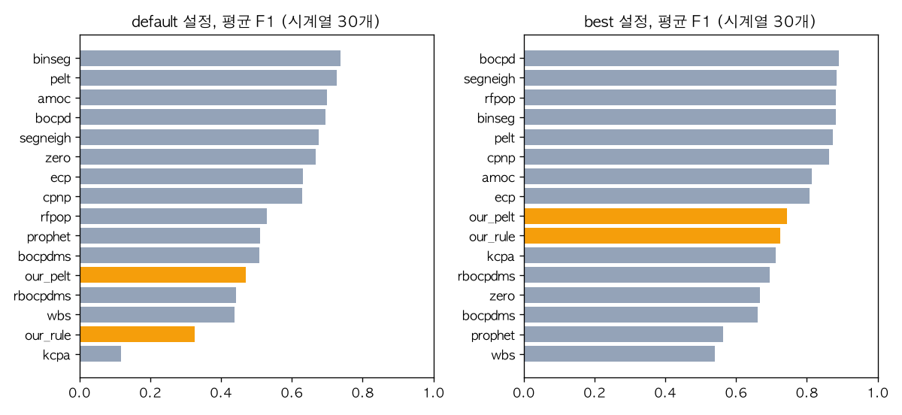
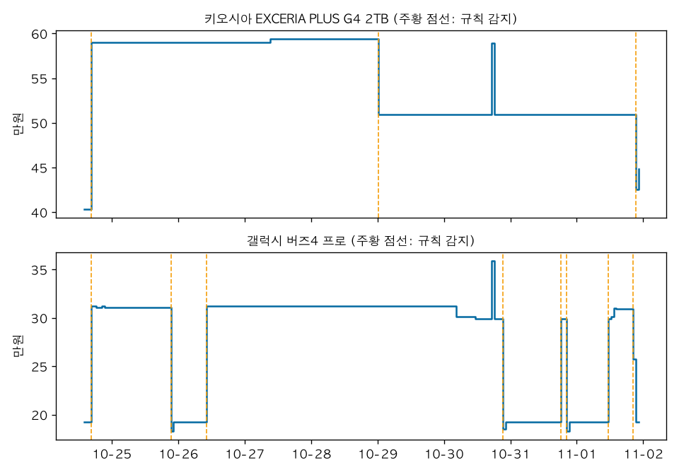

# AN-0002: 급락·변화 감지 알고리즘은 믿을 만한가

- 날짜: 2026-11-02
- 데이터: 연습 쇼핑몰 가격 규칙으로 만든 4주(2026-10-26~11-22) 판매처별 시간 단위 가격 26개, TCPD 단변량 시계열 30개와 TCPDBench 공개 점수, 다나와 상품 20개 1주(AN-0001과 같은 데이터)
- 코드: `analysis/cpd.py`, `analysis/an0002.py`
- 상태: 결론
- 갱신: 2026-11-02 PELT 벌점 고치기 (#40, 5단계)

## 질문

- 급락 감지 코드가 정답을 아는 데이터에서 넣은 패턴을 찾는가.
- 사람이 표시한 변화점이 있는 공개 벤치마크에서, 공개된 알고리즘 14개와 비교하면 어느 정도인가.
- 다나와에 적용하면 무엇을 잡고 무엇을 거르는가. 알림 규칙의 처음 값은 무엇으로 하나 (AN-0001에서 비율 하락 + 지속 시간 + 최소 금액 조건으로 정했다).
- PELT의 벌점을 TCPDBench의 R 구현과 같게 고치면 알림에 쓸 수 있는가 (#40).

## 데이터

- 감지기는 둘이다. `step_rule`은 AN-0001의 제품 규칙이다. 직전 구간 중앙값 대비 min_pct% 이상 바뀐 수준이 persist번 이어지면 변화로 본다. `pelt`는 ruptures의 PELT(L2 비용)에 BIC 꼴 벌점(2·log n·σ², σ는 1차 차분의 MAD)을 붙였다. 5단계에서 R changepoint와 같은 목적함수의 `mbic`를 더했다.
- 연습 쇼핑몰: 정답 변화점은 급락과 주말 할인이 켜지고 꺼지는 시각 238개(그중 급락·할인 시작 124개)다. 매일 자정의 ±3% 변동은 알림 대상이 아니라서 정답에서 뺐다. 허용 오차는 1시간이다.
- TCPD: 단변량이고 데이터가 저장소에 있는 31개 중, TCPDBench의 모든 방법이 성공한 30개로 비교했다 (uk_coal_employ는 한 방법이 실패해서 뺐다). 지표는 TCPDBench와 같은 F1(허용 오차 5칸)과 cover다. default는 정해 둔 설정 하나, best는 시계열마다 가장 좋은 설정의 점수다.
- 결측값은 TCPD에서 앞 값으로 채웠다.

## 시도

### 1. 지표 구현 확인

- TCPDBench의 F1, cover 정의를 `cpd.py`에 다시 구현하고, TCPDBench에 저장된 기본 설정 결과 545개의 점수를 다시 계산했다.
- 처음에는 543개가 같고 2개(scanline_126007 rfpop, scanline_42049 wbs)가 F1에서 0.020, 0.021 달랐다. cover는 같았다. F1의 짝짓기가 탐욕적이라 정답 위치를 도는 순서에 따라 결과가 달라지는데, TCPDBench는 파이썬 set을 도는 순서를 그대로 쓴다. 변화점이 촘촘한 두 시계열에서만 차이가 났다.
- set을 TCPDBench와 같은 순서로 만들자 545개 모두 같아졌다 (최대 차이 2.2e-16).

### 2. 연습 쇼핑몰 정답

| 감지기 | 설정 | 정밀도 | 재현율 | F1 | 급락 시작 재현율 |
|---|---|---|---|---|---|
| 규칙 | 3%, 2시간 | 0.631 | 1.000 | 0.774 | 1.000 |
| 규칙 | 5%, 1시간 | 0.988 | 0.996 | 0.992 | 1.000 |
| 규칙 | 5%, 2시간 | 0.988 | 0.996 | 0.992 | 1.000 |
| 규칙 | 5%, 3시간 | 0.987 | 0.987 | 0.987 | 0.992 |
| 규칙 | 10%, 2시간 | 0.986 | 0.916 | 0.950 | 0.895 |
| 규칙 | 20%, 2시간 | 1.000 | 0.798 | 0.888 | 0.782 |
| PELT | 배율 0.5, 1, 10 | 0.275 | 1.000 | 0.432 | 1.000 |

- 규칙 5%는 거의 다 맞혔다. 3%로 낮추면 날마다 ±3% 변동을 잡아 정밀도가 떨어지고, 10% 이상으로 올리면 일별 변동과 겹친 주말 할인(10%)을 놓친다.
- 다만 5%는 쇼핑몰 규칙(급락 25%, 주말 10%, 일별 ±3%)을 알고 고른 값이다. 이 단계는 코드가 넣은 패턴을 찾는다는 확인이지, 기준값이 맞다는 근거가 아니다.
- PELT는 모든 수준 변화를 찾아서 일별 변동까지 잡는다. 벌점 배율을 0.5~10으로 바꿔도 결과가 같았다. 계단형 가격은 1차 차분이 대부분 0이라 MAD가 0이 되고, σ가 하한값(1e-3)으로 떨어져 벌점이 사실상 0이 됐다. 벌점 추정 방식의 한계다.

### 3. TCPD 벤치마크

| 설정 | 방법 | 평균 F1 | 평균 cover | F1 평균 순위 (16개 중) |
|---|---|---|---|---|
| default | binseg | 0.738 | 0.693 | 4.4 |
| default | pelt (TCPDBench, R changepoint) | 0.728 | 0.695 | 4.6 |
| default | zero (변화점 없음) | 0.668 | 0.575 | 7.0 |
| default | 우리 PELT | 0.471 | 0.369 | 10.5 |
| default | 우리 규칙 | 0.325 | 0.243 | 12.1 |
| best | bocpd | 0.890 | 0.789 | 4.7 |
| best | 우리 PELT | 0.743 | 0.668 | 9.2 |
| best | 우리 규칙 | 0.724 | 0.650 | 8.8 |
| best | zero | 0.668 | 0.575 | 12.1 |

- 정해 둔 설정으로는 우리 두 감지기 모두 "변화점 없음"이라고만 답하는 기준선(0.668)보다 낮다. 규칙(5%, 2시간)은 가격의 계단 변화를 위해 만든 것이라, 잡음이 있고 추세가 있는 일반 시계열에서는 변화점을 너무 많이 찍는다.
- 같은 PELT인데 TCPDBench의 R 구현(MBIC 벌점)은 0.728이고 우리 것은 0.471이다. 차이는 벌점이다. 우리 σ 추정(차분의 MAD)이 작게 나와 변화점을 많이 찍는다.
- 시계열마다 설정을 고르면 둘 다 0.72~0.74로 중간이다. 다만 우리 탐색 범위는 규칙 36개, PELT 8개 설정이고, TCPDBench는 예를 들어 binseg에 1,728개 설정을 썼다. best끼리 같은 조건의 비교는 아니다.

### 4. 다나와 적용

- 1주 동안 상품 20개에서 규칙(5%, 2시간)은 59건, PELT는 203건을 잡았다. 단순히 5% 이상 바뀐 횟수는 88건이다.
- 지속 조건에 따라 건수가 크게 바뀐다: 5% 기준에서 1시간 86건, 2시간 59건, 3시간 42건, 6시간 31건.
- 5% 이상 바뀐 85건(마지막 수집 제외) 중 10건은 바로 다음 수집에 원래 수준(5% 안)으로 돌아갔다. 2시간 조건이 거르는 것이 이런 한 시간짜리 변화다. 그래프의 키오시아 10-30 급등(509,000 → 589,012 → 509,000원)과 버즈4 프로 10-30 급등이 그렇게 걸러졌다.
- 잡힌 것을 AN-0001의 판매처 분석과 대조했다. 키오시아 10-24 16시 상승은 특가 종료, 10-29 0시 13.7% 하락은 92시간 이어진 수준 변화다. 버즈4 프로는 21시 무렵 40% 안팎 하락과 다음 날 상승이 쌍으로 잡혔다(12~21시간 유지). 저녁 특가 패턴과 같다. RTX 5070 두 모델은 88%, 94% 오른 뒤 150시간 넘게 유지됐는데, 실제 시세 변화인지는 확인할 외부 자료가 없다.
- 잡힌 변화가 유지된 시간은 중앙값 11시간, 최대 195시간이다.

### 5. 벌점 고치기 (#40)

- TCPDBench의 default pelt 설정을 래퍼 코드(`execs/R/cpdbench_changepoint.R`, `utils.R`)에서 확인했다. R changepoint의 `cpt.mean(method="PELT", penalty="MBIC", test.stat="Normal")`이고, 넘기기 전에 시계열 전체를 표준화한다(R `scale`). 분산은 1로 둔다. 우리 PELT와 다른 점은 σ를 따로 추정하지 않는 것(표준화로 전체 분산이 1)과 벌점의 크기다.
- changepoint의 MBIC 정의(구간마다 RSS + log(구간 길이), 변화점마다 3·log n)로 `cpd.mbic`를 만들었다. 패키지 소스는 이번에 열어 보지 않았고, 저장된 R 결과와 같은 위치가 나오는지로 확인했다.
- 30개 중 27개에서 R과 변화점 위치가 같았다. 나머지 3개는 목적함수 값을 비교했다.

| 시계열 | R 위치 | 우리 위치 | R 목적함수 | 우리 목적함수 |
|---|---|---|---|---|
| co2_canada | 104, 166 | 104, 165 | 54.496 | 54.496 |
| lga_passengers | 87, 266, 423 | 87, 254, 423 | 279.977 | 278.883 |
| us_population | 312, 562 | 214, 453, 619 | 148.909 | 133.944 |

- co2_canada는 값이 같은 다른 해다. 나머지 둘은 우리 해의 값이 더 낮다. R은 PELT 가지치기로 푸는데, log(구간 길이) 항이 있으면 가지치기 조건이 맞지 않아 최적해를 놓친 것으로 본다 (추정, R을 돌려 확인하지 않았다). 우리는 가지치기 없이 모든 분할을 본다. 시계열이 991칸 이하라 노트북 전체가 51초에 돈다.
- 위치가 같은데 F1이 다른 시계열이 3개(brent_spot, global_co2, ozone) 나왔다. TCPDBench는 패키지가 낸 1부터 센 위치에서 1을 빼서 저장한다. R changepoint는 구간의 마지막 칸을 내므로, 저장된 값은 "바뀌기 직전 칸"이고 우리 표기("새 구간의 첫 칸")보다 1 작다. 우리 결과를 1 당겨서 채점하면 30개 중 29개에서 R과 F1이 같다.
- 이 한 칸이 평균 F1에 주는 영향은 규칙 +0.013, 기존 PELT 0, MBIC +0.012였다. 1~4단계 숫자는 우리 표기 그대로 두었다.

| 방법 | 평균 F1 | 평균 cover | 평균 F1 (TCPDBench 표기) |
|---|---|---|---|
| 규칙 (5%, 2시간) | 0.325 | 0.243 | 0.338 |
| 기존 PELT (차분 MAD) | 0.471 | 0.369 | 0.471 |
| MBIC | 0.713 | 0.690 | 0.725 |
| MBIC (잔차 σ) | 0.708 | 0.644 | 0.688 |
| pelt (TCPDBench, R) | | 0.695 | 0.728 |
| zero (변화점 없음) | | 0.575 | 0.668 |

- MBIC로 바꾸자 "변화점 없음" 기준선(0.668)을 넘었고, R 구현과 0.003 차이다 (us_population 하나).
- 잔차 σ도 해 봤다. 표준화하면 수준 변화까지 분산에 들어가 σ가 크게 잡히니, MBIC로 한 번 나눈 뒤 구간 잔차로 σ를 다시 잡으면 나을 것이라고 봤다. TCPD에서는 σ가 평균 0.53으로 줄었지만 F1은 나아지지 않았다.

연습 쇼핑몰:

| 감지기 | 정밀도 | 재현율 | F1 | 급락 시작 재현율 |
|---|---|---|---|---|
| 규칙 (5%, 2시간) | 0.988 | 0.996 | 0.992 | 1.000 |
| 기존 PELT | 0.275 | 1.000 | 0.432 | 1.000 |
| MBIC | 0.878 | 0.941 | 0.909 | 0.935 |
| MBIC (잔차 σ) | 0.467 | 0.996 | 0.635 | 0.992 |

- MBIC의 오탐 31건은 모두 자정, 일별 ±3% 변동이다. 놓친 것은 급락 켜짐·꺼짐 190개 중 9개, 주말 할인 49개 중 5개다.
- 잔차 σ는 계단형에서 잔차가 거의 0이라 기존 PELT처럼 다시 많이 잡았다.

다나와 1주:

| 상품 변동폭 (최고-최저)/중앙값 | 상품 수 | 규칙 | MBIC | MBIC 중 5% 미만 변화 |
|---|---|---|---|---|
| 13% 미만 | 8 | 3 | 12 | 10 |
| 13~18% | 2 | 2 | 4 | 0 |
| 27% 이상 | 10 | 54 | 22 | 0 |
| 합계 | 20 | 59 | 38 | 10 |

- 잔차 σ MBIC는 88건이다. 규칙과 MBIC가 1시간 안에서 겹친 것은 26건이다.
- 변동폭 13% 미만 상품에서 MBIC는 5% 미만 변화를 10건 잡았다. GIGABYTE RTX는 1주 변동폭이 1.4%인데 2건이다. 변동폭이 큰 10개 상품에서는 MBIC 22건이 모두 규칙 감지와 겹쳤지만, 규칙이 잡은 54건 중 32건을 놓쳤다. 에어팟 프로3는 규칙 14건, MBIC 3건이다.
- 표준화한 뒤 벌점을 고정하면, 기준이 상품마다 그 상품의 1주 변동폭에 맞춰진다. 거의 안 움직이는 상품에서는 작은 변화도 크게 보이고, 특가로 40%씩 오르내리는 상품에서는 같은 크기의 등락이 반복돼도 일부만 나눈다.

## 결과

- 지표 구현은 TCPDBench 공개 점수 545개를 그대로 재현한다.
- 규칙 감지기는 연습 쇼핑몰에서 넣은 급락을 모두 찾는다(F1 0.992). 기준값을 알고 고른 결과다.
- 일반 변화점 벤치마크에서는 정해 둔 설정의 우리 감지기 둘 다 "변화점 없음" 기준선보다 낮다. 공개 알고리즘 상위권(기본 설정 F1 0.73~0.74)과 차이가 크다. PELT 벌점을 고치기 전(1~4단계) 결과다.
- 다나와에서 규칙(5%, 2시간)은 1주 59건, 상품당 주 3건 안팎이고, 한 시간짜리 급등락을 걸렀다. 잡힌 사례는 AN-0001에서 본 특가 시작·종료, 수준 변화와 맞았다.
- PELT의 벌점을 R과 같은 MBIC로 고치면 TCPD에서 R 구현과 같은 수준(평균 F1 0.725, R 0.728, TCPDBench 표기)이 된다. 연습 쇼핑몰 F1은 0.432에서 0.909로 올랐다.
- MBIC는 다나와에서 1주 38건이다. 변동폭이 작은 상품의 5% 미만 변화를 잡고, 변동폭이 큰 상품의 반복 특가는 일부만 잡는다.

## 한계

- 연습 쇼핑몰 정답은 우리가 만든 규칙이라, 그 결과로 기준값을 정당화할 수 없다.
- TCPD는 가격 데이터가 아니다. 경제 계열(유가, 환율, GDP)이 일부 있을 뿐이다.
- 다나와에는 정답이 없다. 사례 몇 개를 판매처 목록과 대조했을 뿐, 전체 59건을 사람이 확인하지 않았다.
- 우리 감지기의 설정 탐색 범위가 TCPDBench보다 훨씬 좁다.
- 다나와 데이터가 1주뿐이다.
- changepoint 패키지 소스와 R 실행으로 확인하지 않았다. MBIC 목적함수는 저장된 결과의 재현(위치 27/30, F1 29/30)으로만 확인했다. R이 최적해를 놓친다는 설명은 추정이다.

## 배운 것

- 공개된 숫자를 재현해 보는 게 지표 구현의 가장 확실한 확인이었다. 탐욕적 짝짓기를 쓰는 F1은 순서에 따라 결과가 달라질 수 있는데, 재현하지 않았다면 몰랐을 것이다.
- 1차 차분의 MAD로 잡음을 추정하면, 계단형 시계열에서는 차분이 대부분 0이라 추정값이 0으로 무너진다. 벌점이 의미를 잃고 모든 변화를 잡는다.
- 가격 계단 변화를 위해 정한 규칙을 일반 변화점 감지기처럼 소개하면 안 된다. 일반 시계열에서는 "아무것도 안 잡는" 기준선보다 못했다.
- "변화점 없음" 기준선이 생각보다 높다(F1 0.668). 감지기를 평가할 때는 이 기준선부터 넘는지 본다.
- 같은 PELT라도 벌점이 F1을 0.47에서 0.71로 바꿨다. 다른 구현과 비교할 때는 알고리즘 이름보다 벌점과 전처리를 먼저 맞춘다.
- TCPDBench 점수를 다른 방법과 비교할 때는 위치 표기(바뀌기 직전 칸, 새 구간 첫 칸)를 맞춰야 한다. 허용 오차가 5칸이어도 평균 F1이 0.01 정도 움직였다.
- 표준화한 뒤 고정 벌점을 쓰면 "그 시계열 안에서 상대적으로 큰 변화"를 찾는다. 모든 상품에 같은 기준(5%)을 쓰는 알림과는 목적이 다르다.
- 가격처럼 잡음이 거의 없는 계단형 데이터에서는 잡음으로 벌점을 정하는 방식(차분 MAD, 잔차 σ)이 모두 무너진다. 어느 크기부터 알릴지는 데이터에서 추정되는 값이 아니라 정해야 하는 값이다.

## 제품에 반영

- 급락 알림의 처음 규칙은 5% 이상, 2시간 이상 유지로 한다. 다나와 1주 기준 상품당 주 3건 안팎이다. 10원 단위 경쟁은 5% 기준에 걸리지 않아 최소 금액 조건은 따로 두지 않는다.
- PELT는 MBIC로 고친 뒤에도 알림에 쓰지 않는다 (#40). 일반 변화점 감지로는 R 구현 수준이지만, 기준이 상품마다 변동폭에 따라 달라져서 "5% 넘게 바뀌면 알림"과 맞지 않는다.
- 다음에 할 것: 다나와 데이터가 3~4주 쌓이면 감지 결과 일부를 사람이 표시한 정답과 비교한다.
