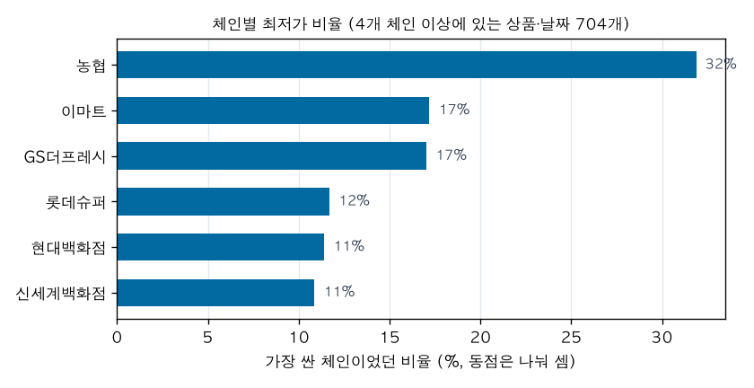
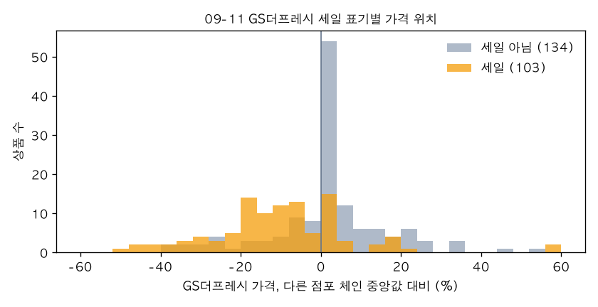

# AN-0003: 판매점 간 가격 비교와 할인 판별

- 날짜: 2026-11-02
- 데이터: 한국소비자원 참가격 생필품 가격 파일 20260925판(조사일 2026-09-11, 09-25, 235,632행), 다나와 상품 20개 1주(AN-0001과 같은 데이터, 판매처 목록 45,062행)
- 코드: `analysis/an0003.py`
- 출처: 한국소비자원 참가격 (공공데이터포털 15083256)
- 상태: 1차 결론. 과거 이력, 통계청 품목 지수 대조, Cavallo(2017) 재현은 #37의 키와 자료를 받은 뒤 #42에서 한다

## 질문

- 같은 체인 안에서 점포마다 가격이 다른가. 다르다면 경쟁사 가격을 점포 단위로 봐야 한다.
- 체인끼리 가격은 얼마나 다르고, 어느 체인이 가장 싼가. 가장 싼 체인은 2주 사이에 바뀌는가.
- 세일 표기가 있는 데이터에서, 가격만으로 세일을 맞힐 수 있는가. 맞힌다면 어떤 기준이 나은가.
- 가장 싼 판매처가 세일이나 특가 때문에 가장 싼 경우가 얼마나 되나. 다나와에서는 어떤가.

## 데이터

- 참가격 파일 열: 상품명, 조사일, 판매가격, 판매업소, 제조사, 세일여부, 원플러스원. 인코딩은 cp949다.
- 판매업소 이름 앞부분으로 체인을 나눴다. 롯데슈퍼 160곳, GS더프레시 124곳, 이마트 130곳, 현대백화점 14곳, 농협(농협유통, 농협하나로유통) 12곳, 신세계백화점 5곳, 편의점 3곳(GS25·CU·세븐일레븐 본사)이다.
- 체인 가격은 그 체인 점포들의 최빈가로 잡았다.
- 세일여부는 86%가 비어 있다. 거의 다 채워진 것은 GS더프레시 09-11(Y 6,914, N 16,674, 빈칸 100)뿐이다. GS더프레시 09-25는 Y 7,123, 빈칸 16,588이고 N이 하나도 없다. 09-25 빈칸은 세일 아님으로 봤다. 확인한 것이 아니라 가정이다. 롯데슈퍼, 이마트, 현대백화점은 거의 비어 있다.
- 다나와는 AN-0001과 같은 1주 데이터다. 판매처는 쇼핑몰 단위(G마켓, 11번가 등)이고 상위 10곳까지다. 배송비는 이 데이터를 받은 뒤(#33)에 고쳐서 쓰지 않았다.

## 시도

### 1. 체인 안에서 점포끼리 가격이 같은가

점포가 2곳 이상인 상품·날짜 기준. 편의점은 점포가 아니라 세 회사 본사 가격끼리 비교한 것이다.

| 체인 | 상품·날짜 | 최빈가 비율 (점포 가중) | 모든 점포가 같은 가격 | 점포 간 최고/최저 차이 중앙값 |
|---|---|---|---|---|
| 이마트 | 791 | 0.997 | 0.737 | 0% |
| GS더프레시 | 380 | 0.994 | 0.821 | 0% |
| 현대백화점 | 842 | 0.977 | 0.824 | 0% |
| 편의점 | 280 | 0.913 | 0.786 | 0% |
| 롯데슈퍼 | 579 | 0.881 | 0.399 | 10.0% |
| 농협 | 427 | 0.881 | 0.363 | 7.7% |
| 신세계백화점 | 254 | 0.739 | 0.476 | 2.3% |

- 이마트, GS더프레시, 현대백화점은 점포 98~100%가 체인 최빈가와 같다. 세일도 체인 단위다. GS더프레시 09-11 상품 342개 중 103개는 모든 점포가 Y, 234개는 모든 점포가 N이었다. 섞인 상품은 5개다.
- 롯데슈퍼는 12%가 최빈가와 다르다. 점포별로는 0~28%(중앙값 14.2%)이고, 다른 경우의 97%가 최빈가보다 비쌌다. 체인 가격에 일부 점포가 웃돈을 얹는 모양이다. 어떤 점포가 왜 비싼지는 이 데이터로 알 수 없다.
- 비교 대상: DellaVigna & Gentzkow (2019, QJE 134(4))는 미국 식료품·약국·대형마트 체인 대부분이 점포의 소득 수준이나 경쟁과 관계없이 거의 같은 가격을 받는다고 보고했다. 이마트, GS더프레시, 현대백화점은 같은 방향이다. 롯데슈퍼와 농협은 그보다 점포 차이가 있다. 논문의 측정 방식과 같게 맞추지는 않았다.

### 2. 체인끼리 가격 차이와 가장 싼 체인

점포 체인 6곳 중 4곳 이상에 있는 상품·날짜 704개 기준.

- 같은 상품의 체인 간 최고/최저 차이는 중앙값 31.7%(사분위 17.1~57.3%, 90% 지점 103%)다.
- 가장 싼 체인이었던 비율(동점은 나눠 셈): 농협 31.9%, 이마트 17.2%, GS더프레시 17.0%, 롯데슈퍼 11.7%, 현대백화점 11.4%, 신세계백화점 10.9%. 상품별 중앙값 대비로는 농협만 -2.8%이고 나머지는 0%다.
- 체인 가격이 상품별 체인 중앙값과 정확히 같은 경우가 체인마다 15~31%다. 모든 체인이 같은 가격인 경우는 2.1%이고, 가장 싼 체인이 둘 이상(동점)인 경우는 25%다.
- 편의점 본사 가격은 점포 체인 중앙값보다 17.6% 비싸다 (상품·날짜 473개).
- 두 날짜 모두 4개 체인 이상에 있고 가장 싼 체인이 하나인 상품 220개 중 87개(40%)는 2주 사이에 가장 싼 체인이 바뀌었다.

### 3. 2주 사이 가격 변화 (체인 가격 기준)

| 체인 | 상품 | 바뀐 비율 | 내림 | 올림 | 바뀐 폭 중앙값 |
|---|---|---|---|---|---|
| 농협 | 317 | 0.492 | 0.360 | 0.132 | 12.7% |
| 롯데슈퍼 | 332 | 0.250 | 0.114 | 0.136 | 22.9% |
| 이마트 | 419 | 0.217 | 0.107 | 0.110 | 15.7% |
| GS더프레시 | 338 | 0.204 | 0.104 | 0.101 | 16.3% |
| 신세계백화점 | 238 | 0.160 | 0.134 | 0.025 | 11.6% |
| 현대백화점 | 452 | 0.142 | 0.084 | 0.058 | 9.6% |
| 편의점 | 240 | 0.021 | 0.000 | 0.021 | 12.5% |

- 2주 사이 체인 가격의 14~49%가 바뀌었고, 바뀔 때는 10~23%씩 바뀌었다. 작은 조정보다 세일 시작·종료처럼 큰 변화가 많다. 다나와의 10원 단위 경쟁(AN-0001)과 다르다.

### 4. 세일 표기와 가격 변화: GS더프레시

| 09-11 → 09-25 | 상품 | 가격 같음 | 내림 | 올림 | 변화 중앙값 |
|---|---|---|---|---|---|
| N → N | 125 | 0.968 | 0.016 | 0.016 | 0% |
| N → Y | 11 | 0 | 0.909 | 0.091 | -16.3% |
| Y → N | 15 | 0 | 0.067 | 0.933 | +31.7% |
| Y → Y | 88 | 0.830 | 0.080 | 0.091 | 0% |

- 세일 표기가 바뀐 상품은 모두 가격이 바뀌었고, 표기가 같은 상품은 대부분 가격도 같았다. 09-25 빈칸을 세일 아님으로 본 가정과 어긋나지 않는다.
- 세일이 끝난 상품(Y→N)은 중앙값 31.7% 올랐다. 세일 가격이 정상가보다 24% 안팎 싸다는 뜻이다 (1 - 1/1.317).
- 세일 중인 상품 103개 중 88개는 2주 뒤에도 세일이었다. 세일이 2주 넘게 이어지는 경우가 많다.

### 5. 가격만으로 세일을 맞힐 수 있나

정답은 GS더프레시 상품별 세일 표기다. 두 가지 기준을 비교했다.

- 시점 비교: 같은 체인의 다른 날짜 가격보다 x% 이상 싸다.
- 체인 비교: 같은 날 다른 점포 체인 가격의 중앙값보다 x% 이상 싸다.

| 날짜 | 기준 | 방법 | 예측 | 정밀도 | 재현율 | F1 |
|---|---|---|---|---|---|---|
| 09-11 (세일 103 / 237) | 5% | 시점 비교 | 24 | 0.875 | 0.204 | 0.331 |
| | 5% | 체인 비교 | 96 | 0.708 | 0.660 | 0.683 |
| | 3% | 둘 중 하나 | 108 | 0.685 | 0.718 | 0.701 |
| | 10% | 체인 비교 | 68 | 0.721 | 0.476 | 0.573 |
| 09-25 (세일 99 / 236) | 5% | 시점 비교 | 18 | 0.833 | 0.152 | 0.256 |
| | 5% | 체인 비교 | 93 | 0.645 | 0.606 | 0.625 |
| | 3% | 둘 중 하나 | 112 | 0.616 | 0.697 | 0.654 |
| | 10% | 체인 비교 | 66 | 0.697 | 0.465 | 0.558 |

전체 표(3·5·10·20%, 네 방법)는 `an0003.py` 출력에 있다.

- 시점 비교는 맞힐 때는 정확하지만(정밀도 0.83~0.88) 세일의 15~20%만 찾는다. 세일이 2주 넘게 이어져서(4단계의 Y→Y 88개) 두 날짜 가격이 같기 때문이다. 이 데이터에서 시점 비교는 세일이 시작되거나 끝난 것만 잡는다.
- 체인 비교가 낫다. 그래도 F1 0.62~0.70이 이 데이터에서 본 최고였다. 세일 상품 가격은 다른 체인 중앙값보다 중앙값 9.1% 쌌지만, 4분의 1 이상은 다른 체인보다 싸지 않았다(75% 지점 0%). 세일이 아닌 상품도 다른 체인보다 싼 경우가 있다(25% 지점 -3.1%).
- 기준을 10%, 20%로 올리면 정밀도는 거의 그대로(0.59~0.72)이고 재현율만 떨어진다. 세일 폭과 체인 간 가격 차이가 겹쳐 있다.

### 6. 가장 싼 체인은 세일 때문인가

- GS더프레시가 가장 싼 상품은 09-11에 94개, 09-25에 73개였다. 그중 세일 표기가 있는 상품의 비율은 09-11 42/77(55%, 표기 없는 17개 제외), 09-25 38/71(54%, 2개 제외)이다.
- 가장 싼 체인이라도 절반 정도는 세일 가격이다. 정상가끼리 비교하면 순위가 달라질 수 있다.

### 7. 다나와 적용

판매처의 평소 가격은 그 판매처(쇼핑몰)의 1주 가격 중앙값으로 잡았다. 평소 가격보다 5% 이상 싸면 할인 중으로 봤다.

- 판매처·상품 조합 397개, 수집 행의 4.1%가 할인 중이었다.
- 1위 판매처가 할인 중인 시각이 14.3%다.
- 같은 수집에서 할인 중이 아닌 판매처의 최저가와 실제 최저가를 비교하면, 89.4%는 같고 8.8%는 5% 이상 차이 난다. 차이 날 때의 중앙값은 67.4%로 크다. 상품별로 보면 에어팟 프로3(96회, 중앙값 93.8%), RTX 5070 두 모델(47회씩, 78.4%, 67.4%), 갤럭시 버즈 세 모델(33~46회, 55~75%)이 대부분이다.
- 에어팟 프로3는 G마켓 134,100원이 1위일 때가 많았는데, G마켓의 평소 가격은 198,160원이고 다른 판매처는 26만 원대였다. RTX 5070 INFINITY 3은 11번가 694,870원(평소 1,368,850원)이었다. 이 가격들이 정상 판매인지, 다른 구성품이거나 잘못 등록된 것인지는 확인하지 않았다.
- G마켓과 옥션이 같은 수집에 다 있을 때(3,849회) 가격이 같은 경우는 57.3%다. 오프라인 체인처럼 계열 쇼핑몰끼리 가격을 맞추지는 않는다. 다만 판매처가 쇼핑몰 단위라 그 안의 판매자가 다를 수 있다.

## 결과

- 이마트, GS더프레시, 현대백화점은 같은 날 점포 98% 이상이 같은 가격이고 세일도 체인 단위다. 롯데슈퍼와 농협은 점포의 12%가 다르고, 롯데슈퍼는 다를 때 거의 다 비싸다.
- 같은 상품의 체인 간 가격 차이는 중앙값 31.7%다. 가장 싼 체인은 농협이 31.9%로 가장 많고, 2주 사이에 상품 40%에서 가장 싼 체인이 바뀌었다.
- 가격만으로 세일을 맞히면 다른 체인과 비교하는 방법이 F1 0.62~0.70으로 가장 나았다. 두 날짜만 있는 시점 비교는 세일 시작·종료만 잡는다(재현율 0.15~0.20).
- 가장 싼 체인의 절반 정도는 세일 가격이다(GS더프레시 54~55%). 다나와에서는 1위가 할인 중인 시각이 14.3%, 할인을 빼면 최저가가 5% 이상 달라지는 시각이 8.8%다.

## 한계

- 조사일이 이틀뿐이다. 가격 변화 빈도, 세일 기간, 시점 비교 성능은 2주 간격 두 번의 관측으로만 본 것이다.
- 세일 정답은 GS더프레시 한 체인이고, 09-25는 빈칸을 세일 아님으로 본 가정이 들어갔다.
- 체인은 판매업소 이름 앞부분으로 나눴다. 체인 가격은 최빈가라, 점포 차이가 있는 롯데슈퍼·농협·신세계백화점에서는 대표성이 떨어진다.
- 참가격은 오프라인 매장 중심이고, 온라인 오픈마켓과 가격을 정하는 방식이 다를 수 있다.
- 다나와는 1주, 상품 20개, 판매처는 쇼핑몰 단위다. 평소 가격(1주 중앙값)이 할인 정답은 아니다. 에어팟·RTX의 낮은 가격이 정상 판매인지 확인하지 않았다.
- 통계청 품목 지수 대조와 Cavallo(2017) 재현은 하지 않았다 (#42, #37 이후).

## 배운 것

- 오프라인 대형 체인은 체인 단위로 가격을 정한다. 경쟁사 가격을 볼 때 점포를 다 모을 필요가 없고, 롯데슈퍼처럼 점포 차이가 있는 체인만 따로 본다.
- 세일 표기의 의미가 날짜마다 달랐다 (09-11 Y/N, 09-25 Y/빈칸). 표기 열을 정답으로 쓰기 전에 날짜별로 값 분포부터 봐야 한다.
- 세일은 "다른 곳보다 싸다"와 같은 말이 아니다. GS더프레시 세일 상품의 4분의 1 이상이 다른 체인보다 싸지 않았다. 가격만으로 세일을 판별하는 데는 이 겹침만큼 한계가 있다.
- 관측 간격이 세일 기간보다 길면 "직전보다 싸졌다"는 기준은 세일을 대부분 놓친다. 다나와처럼 매시 보는 데이터에서는 다를 수 있다.

## 제품에 반영

- 고려한다: 판매처별 "평소 가격"(그 판매처의 지난 가격 중앙값)을 같이 보여 주기. 다나와 1위의 14.3%가 할인 중이고, 할인을 빼면 최저가가 크게 달라지는 상품(에어팟, 버즈)이 있다. AN-0001의 "덜 흔들리는 지표" 후보와 같이 본다.
- 고려한다: 할인 판별은 시점 비교(자기 평소 가격 대비)와 다른 판매처 대비 위치를 같이 쓴다. 참가격에서 다른 체인 비교가 시점 비교보다 나았지만, 관측이 이틀뿐이라 매시 수집하는 다나와에서 다시 확인한다.
- 만들지 않는다: 오프라인 체인을 점포 단위로 수집하는 기능. 대형 체인은 점포 가격이 거의 같다.
- 다음에 할 것 (#42, #37 이후): 참가격 Open API로 과거 이력을 받아 세일 주기와 시점 비교를 다시 보고, 통계청 품목 지수와 비교한다. Cavallo(2017) 자료에 원자료가 있으면 같은 가격 비율을 재현한다.
