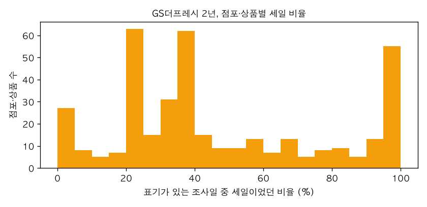
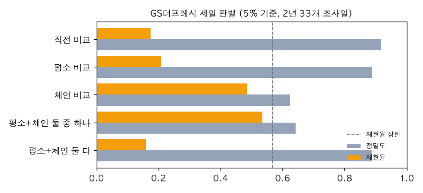
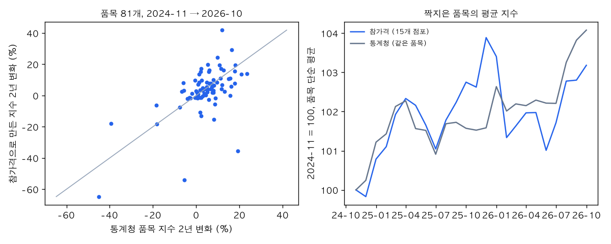

# AN-0004: 2년 이력이 있으면 가격만으로 세일을 더 잘 찾나, 우리 계산이 공식 통계·선행 연구와 맞나

- 날짜: 2026-11-04
- 데이터: 참가격 Open API 15개 점포 x 46개 조사일(2024-11-08 ~ 2026-10-23, 179,936행, 상품 652개), 통계청 지출목적별 소비자물가지수(품목 포함) 전국 2024-10 ~ 2026-10, Cavallo(2017) 복제 자료 원자료 45,253행
- 코드: `analysis/an0004.py`, `analysis/chamgagyeok_api.py`, `analysis/fetch_external.py` (kosis, cavallo2017)
- 출처: 한국소비자원 참가격(공공데이터포털 15158701), 통계청 KOSIS DT_1J22001, Cavallo, A. (2017) "Are Online and Offline Prices Similar? Evidence from Large Multi-Channel Retailers", AER 107(1) (복제 자료 openICPSR E113131V1, 데이터 CC BY 4.0)
- 상태: 결론. AN-0003(#31)의 후속 (#42)

## 질문

- AN-0003은 조사일이 이틀뿐이라 "시점 비교"(같은 점포의 다른 날 가격보다 싸면 세일)의 재현율이 0.15~0.20이었다. 이력이 길어 "평소 가격"을 잡을 수 있으면 나아지는가.
- 세일은 얼마나 길고 얼마나 자주 하나. 가격 기반 판별이 어디서 막히나.
- 참가격 몇 개 점포로 만든 품목 가격 지수가 통계청 품목 지수와 같은 방향으로 움직이는가. 맞는다면 우리 수집 데이터로 "시장 가격 흐름"을 보여 줄 근거가 된다.
- 공개된 온·오프라인 가격 연구(Cavallo 2017)의 원자료로 같은 숫자가 나오는가. 우리 계산 방식(같은 가격 비율, 가격 변경 빈도·크기)이 선행 연구와 같은 정의인지 확인한다.

## 데이터

### 참가격 Open API

- 상세기능 "생필품 가격 정보 조회"는 조사일(`goodInspectDay`)이 필수이고 점포(`entpId`)나 상품(`goodId`) 중 하나가 필요하다. 한 번 호출로 한 점포의 한 조사일 전 상품, 또는 한 상품의 한 조사일 전 점포가 나온다. 개발계정은 상세기능마다 하루 2,000건이다.
- 응답에 할인 시작일·종료일(`goodDcStartDay`, `goodDcEndDay`)이 있다. 파일 데이터(AN-0003)에는 없던 값이다.
- 조사일 찾기: 명세에는 "매주 금요일"이라고 되어 있지만 처음 찍어 본 날짜(2025-09-26, 2023-09-29 등)는 비어 있었다. 2024-11 ~ 2026-10의 금요일 105개를 꽃소금(goodId 35)으로 조회해 결과가 있는 46일을 조사일로 썼다. 간격은 14일 38번, 21일 5번, 35일 1번, 42일 1번이다. 2026-08-14(광복절)처럼 공휴일 주는 비어 있었다.
- 점포 고르기: 전 점포 x 46일은 호출 수가 너무 많다. AN-0003에서 같은 체인 안 점포 가격이 98~100% 같았던 것(이마트, GS더프레시, 현대백화점)을 근거로 체인마다 2곳(편의점은 본사 1곳)만 받았다. 2026-09 파일에서 상품이 많은 점포 순으로, 2024-11-08과 2025-09-19 모두 자료가 있는 점포를 골랐다. 롯데슈퍼언남점은 AN-0003에서 최빈가와 다른 비율이 가장 높았던 점포(28%)인데 그대로 들어갔다.
- 호출: 2026-11-04 가격 조회 811건(조사일 찾기와 점포 확인 포함). 한 번 `ConnectTimeout`이 나서 재시도를 넣었다.

체인별 행과 세일 표기(Y, N, 빈칸):

| 체인 | 점포 | 상품 | 행 | Y | N | 빈칸 |
|---|---|---|---|---|---|---|
| GS더프레시 | 2 | 390 | 19,860 | 7,998 | 6,538 | 5,324 |
| 농협 | 2 | 510 | 31,145 | 6,184 | 7,737 | 17,224 |
| 롯데슈퍼 | 2 | 396 | 24,486 | 927 | 3,209 | 20,350 |
| 이마트 | 2 | 483 | 32,136 | 242 | 2,106 | 29,788 |
| 현대백화점 | 2 | 469 | 31,507 | 180 | 6,208 | 25,119 |
| 신세계백화점 | 2 | 520 | 22,146 | 101 | 2,452 | 19,593 |
| GS25 | 1 | 272 | 7,176 | 57 | 4,307 | 2,812 |
| 세븐일레븐 | 1 | 171 | 5,124 | 19 | 4,390 | 715 |
| CU | 1 | 257 | 6,356 | 25 | 180 | 6,151 |

- 표기는 체인과 조사일마다 남는 정도가 다르다. 점포·조사일별로 상품의 80% 이상에 Y나 N이 있는 날만 정답으로 썼고, 그 안에서도 빈칸 행은 뺐다. AN-0003은 09-25의 빈칸을 N으로 가정했는데, 이번에는 가정하지 않았다. 그 결과 GS더프레시는 33개 조사일, 이마트는 0개가 남았다.
- 세일이 실제로 많고 표기도 남는 곳은 GS더프레시와 농협뿐이다. 그래서 세일 분석은 GS더프레시 중심이다.

### 통계청, Cavallo

- KOSIS DT_1J22001(지출목적별 소비자물가지수, 품목 포함, 2020=100) 전국 579개 항목 x 25개월 14,525칸.
- Cavallo 복제 자료는 사용자가 openICPSR에서 받아 저장소 루트에 넣은 것을 `analysis/data/external/cavallo2017/`로 옮겼다(커밋하지 않음). 원자료 `online_offline_ALL_clean.dta`(45,253행)와 Stata 코드가 있다. 비교 대상 수치는 NBER 워킹페이퍼 w22142 rev0(결과 2016-03-23)의 표다. AER 게재본의 표와 같은지는 확인하지 않았다.

## 시도

### 1. 세일은 얼마나 길고 얼마나 자주 하나

할인 시작일~종료일로 잰 세일 기간(같은 점포·상품·기간은 한 번):

| 체인 | 기간 수 | 10% | 중앙값 | 90% |
|---|---|---|---|---|
| GS더프레시 | 6,076 | 7일 | 21일 | 31일 |
| 농협 | 5,866 | 14일 | 14일 | 15.5일 |
| 롯데슈퍼 | 818 | 7일 | 14일 | 31일 |
| 이마트 | 242 | 7일 | 14일 | 21일 |
| GS25 | 57 | 28일 | 30일 | 31일 |

- 농협은 거의 모두 14일이다. 편의점은 한 달 단위다. 농협 기간 중 최솟값이 -14일(종료일이 시작일보다 앞섬)인 행이 있었다. 원자료 오류로 보고 고치지 않았다.
- GS더프레시 점포·상품 379개(표기 조사일 10개 이상)의 세일 조사일 비율은 중앙값 36.4%, 평균 47%다. 한 번도 세일이 아닌 것은 6.9%, 절반 넘게 세일인 것은 35.6%, 90분위가 100%다. 2년 내내 "세일"인 상품이 있다.
- 한 세일이 끝나고 다음 세일이 시작하기까지 중앙값 1일이고, 55.9%는 1일 이하(바로 이어지거나 겹침)였다.
- 세일 가격을 같은 점포·상품의 세일 아닌 조사일 가격 중앙값과 비교하면 중앙값 -7.7%, 하위 25% -20.1%다. 39.2%는 평소 가격과 같거나 비쌌다.

### 2. 가격만으로 세일을 판별: 이력이 길면 나아지나

정답은 표기가 남은 조사일의 Y/N. 세 가지 기준을 x%(3, 5, 10, 20%)로 봤다.

- 직전 비교: 같은 점포의 직전 조사일 가격보다 x% 이상 싸다 (AN-0003의 시점 비교)
- 평소 비교: 같은 점포의 직전 6개 조사일 가격 중앙값보다 x% 이상 싸다 (3개 이상 있을 때). 다나와에서 쓰려던 "판매처별 평소 가격"과 같은 생각이다
- 체인 비교: 같은 날 다른 점포 체인(3곳 이상) 가격 중앙값보다 x% 이상 싸다 (AN-0003과 같음)

GS더프레시 7,230행(세일 3,118, 43%), 5% 기준:

| 방법 | 정밀도 | 재현율 | F1 |
|---|---|---|---|
| 직전 비교 | 0.917 | 0.174 | 0.293 |
| 평소 비교 | 0.889 | 0.208 | 0.337 |
| 체인 비교 | 0.625 | 0.487 | 0.547 |
| 평소+체인 둘 중 하나 | 0.642 | 0.535 | 0.583 |
| 평소+체인 둘 다 | 0.888 | 0.160 | 0.271 |

- 3% 기준에서 체인 비교 F1 0.567, 둘 중 하나 0.602로 가장 높았다. 10%, 20%로 올리면 모두 재현율이 떨어졌다.
- 평소 비교는 직전 비교보다 재현율이 0.03~0.05 높았을 뿐이다. 평소 비교(5%)가 놓친 세일은 GS 세일의 79.2%이고, 그중 93.8%는 직전 조사일도 세일이었다. 세일이 길거나 연달아 이어지면 "평소 가격" 자체가 세일 가격이 된다.
- 자기 가격만 쓰는 방법의 상한: 2년 전체의 세일 아닌 가격 중앙값(사후에야 아는 값)보다 5% 이상 싼 세일이 56.7%다. 나머지는 자기 평소 가격과 거의 같아서 직전·평소 비교로는 찾을 수 없다. 체인 비교는 이 상한에 묶이지 않지만, 재현율은 0.487이었다.
- 5개 체인 전체(19,771행, 세일 24.5%)에서는 5% 체인 비교 F1 0.479, 평소 비교 0.399로 GS보다 낮았다.
- AN-0003(두 날짜, GS)과 비교: 체인 비교 F1 0.62~0.70 → 0.55~0.57, 시점 비교 재현율 0.15~0.20 → 직전 0.17~0.18, 평소 0.21~0.23. 정답 처리(AN-0003은 09-25 빈칸을 N으로 봄)와 비교 체인 가격(AN-0003은 체인 전 점포 최빈가)이 달라서 그대로 비교할 수는 없다.

### 3. 통계청 품목 지수와 대조

- 참가격 상품 소분류 이름이 통계청 품목 이름과 같은 94개는 그대로 짝지었다. 이름이 다른 16개 소분류(계란→달걀, 쌀(백미)→쌀, 포기김치→김치 등, 코드의 `ALIASES`)는 같은 품목으로 묶었다. 점포·상품 3개 이상, 24개월 모두 값이 있는 81개 품목이 남았다.
- 참가격 지수: 점포·상품마다 월 평균 가격(조사일 1~3번)을 내고, 두 달 모두 있는 점포·상품의 가격 비율을 기하평균(Jevons)해 이었다. 둘 다 2024-11 = 100. 가중치는 없다. 세일 가격도 들어 있다.

| | 품목 | 2년 변화 상관 | 방향 같음 | 차이 절댓값 중앙값 |
|---|---|---|---|---|
| 전체 | 81 | 0.585 (순위 0.52) | 75.3% | |
| 가공·생활용품 | 69 | 0.478 | 75.4% | 3.7%p |
| 신선식품 | 12 | 0.554 | 75.0% | 14.0%p |

- 차이가 큰 품목: 고등어 참가격 -35.4% / 통계청 +19.4% (점포·상품 8개), 양배추 -54.0% / -5.4%, 돼지고기 +41.9% / +12.0%. 신선식품은 상품 수가 적고 변동이 커서 차이가 크다.
- 월 변화율 상관은 품목별 중앙값 0.24(사분위 0~0.44)로 낮다. 월 변화 크기 중앙값이 참가격 1.16%, 통계청 0.77%로 참가격이 더 흔들린다. 세일 가격이 섞여 있고 점포가 15곳뿐인 것이 이유로 보인다(나눠서 확인하지는 않았다).
- 81개 품목 단순 평균 지수의 2년 변화는 참가격 +3.2%, 통계청 +4.1%.

### 4. Cavallo(2017) 재현

복제 자료의 `CODE/stats-retailers.do`, `stats-time-country.do`를 pandas로 옮겼다. 정의: 온라인 가격/오프라인 가격 - 1이 0.1% 미만이면 같음, 50% 넘으면 매칭 오류로 뺌. 세일 표시는 오프라인 메모(`COMMENTS`에 s, sale, s...off), 가격 유형, 온라인 세일 표시.

- 표본: 처음에 대체 입력값 포함/제외, 세일 포함/제외 네 가지를 다 계산해 봤다. 논문 표 3의 관측 수(38,383)와 맞는 것은 "세일 제외, 대체 입력값 포함"이었다. 논문 본문에도 "The main tables also exclude sale prices"라고 되어 있다.
- 표 3(나라별 가격 수준): 관측 수, 같은 가격 비율, 다를 때 차이를 반올림해 논문과 비교하면 11개 행 33칸 모두 같았다. 전체 같은 가격 71.5%(논문 72%), 온라인이 비쌈 10.6%(11%), 쌈 17.9%(18%), 다를 때 차이 -4.0%(-4%), 평균 차이 -1.1%(-1%).
- 세일 포함: 관측 43,588, 같은 가격 67.2%, 세일 비중 11.9%(논문 "about 11%"), 세일 가격 중 같음 35.6%(논문 36%).
- 표 5, 6(가격 변경): 전체 관측 14,368(논문 14,367), 가격 변경 1,331(같음), 동시 변경 18.6%(19%), 빈도 온라인 0.076 / 오프라인 0.068(같음), 크기 22.02% / 20.03%(22.02 / 19.98).
- 나라별로는 몇 건씩 달랐다. 영국 가격 변경 27건 / 논문 25건, 동시 41% / 44%, 미국 563 / 561, 아르헨티나 246 / 247, 브라질 84 / 85, 독일 오프라인 크기 15.86 / 16.52. Stata는 `sort nid date`에서 같은 상품·같은 날짜 행의 순서를 정하지 않는데, pandas는 원래 순서를 유지한다. 그 차이로 직전 가격이 달라졌을 것으로 추정한다(확인하지 않았다).

## 결과

- 이력이 길어도 가격만 쓰는 세일 판별은 크게 나아지지 않았다. GS더프레시 5% 기준 재현율: 직전 비교 0.174 → 평소 비교 0.208. 같은 날 다른 체인과 비교하는 쪽이 0.487로 훨씬 낫고, 둘을 합치면 0.535다.
- 막히는 이유는 세일의 모양이다. GS더프레시 세일은 중앙값 21일, 다음 세일까지 중앙값 1일이라 바로 이어지는 경우가 절반이 넘는다. 세일 가격의 39%는 평소 가격과 같거나 비싸다. 가격만 쓰는 방법의 재현율 상한이 0.567이다.
- 참가격 15개 점포로 만든 품목 지수는 통계청 품목 지수와 2년 변화 방향이 75% 같고 상관 0.585다. 가공·생활용품은 차이 중앙값 3.7%p, 신선식품은 14.0%p. 월 단위로는 거의 맞지 않는다(상관 중앙값 0.24).
- Cavallo(2017)의 표 3은 원자료로 정확히 재현됐고, 표 5, 6은 전체 행이 같고 나라별로 몇 건 차이다. 같은 가격 비율, 가격 변경 빈도·크기를 우리가 같은 정의로 계산할 수 있다.

## 한계

- 체인마다 점포 1~2곳이다. 체인 안 점포 가격이 같다는 AN-0003 결과(2026-09 이틀)에 기댄 것이고, 2년 내내 그런지는 보지 않았다.
- 세일 정답은 GS더프레시 33개 조사일이 대부분이다. 표기 Y가 무엇을 뜻하는지(가격 인하, 카드 할인, 증정 등) 명세에 없다. 평소와 같은 가격인 "세일" 39%가 표기 오류인지, 가격이 아닌 혜택인지는 모른다. 원플러스원은 따로(`plusoneYn`) 있다.
- "평소 가격"은 표기 N인 조사일만으로 잡았다. 2년 내내 세일인 상품은 평소 가격이 없어서 상한 계산에서 빠졌다.
- 통계청 대조는 이름으로만 짝지었고, 규격(용량)과 가중치가 다르다. 참가격 지수에는 세일 가격이 섞여 있다. 신선식품 품목은 12개뿐이다.
- Cavallo 비교 대상은 워킹페이퍼 rev0다. 이 재현은 계산 정의를 맞춰 본 것이지 한국 온·오프라인 가격을 비교한 것이 아니다. 같은 체인의 온라인 가격은 받지 않았다.

## 배운 것

- 평소 가격을 "직전 몇 번의 중앙값"으로 잡으면, 세일이 길게 이어지는 판매처에서는 세일 가격이 평소 가격이 된다. 기간을 늘린다고 풀리지 않는다. 이번에 본 기준 중에서는 같은 날 다른 판매처 가격만 이 문제를 피했다.
- 두 날짜로 본 AN-0003의 체인 비교 F1(0.62~0.70)이 2년(0.55~0.57)보다 높았다. 정답 처리도 달랐지만, 짧은 기간 결과로 기준값을 정하면 안 된다는 것은 확인했다.
- API 명세의 "매주 금요일"과 실제 조사일(대체로 2주 간격, 공휴일 주는 빔)이 달랐다. 날짜를 한 상품으로 먼저 찍어 보고 범위를 정한 것이 호출 수를 아꼈다.
- 원자료 재현에서 표본 조건(세일 포함 여부, 대체 입력값)을 하나씩 바꿔 관측 수가 맞는 조합을 먼저 찾으니, 나머지 숫자는 그대로 맞았다.

## 제품에 반영

- 할인 판별은 AN-0003에서 정한 대로 자기 평소 가격과 다른 판매처 대비 위치를 같이 쓴다. 이번 결과로 다른 판매처 대비 위치를 주 기준으로 하고, 자기 평소 가격은 보조로 둔다.
- "할인 중" 표시는 판매처가 붙인 표기 없이 가격만으로는 절반 정도만 잡힌다는 것을 알고 쓴다. 가격만으로 "할인 아님"이라고 단정하는 문구는 넣지 않는다.
- 통계청 지수 대신 쓸 수 있는 "시장 물가 지수" 기능은 만들지 않는다. 방향은 75% 맞지만 품목별 차이가 크다. 이 판단은 Claude가 했다.
