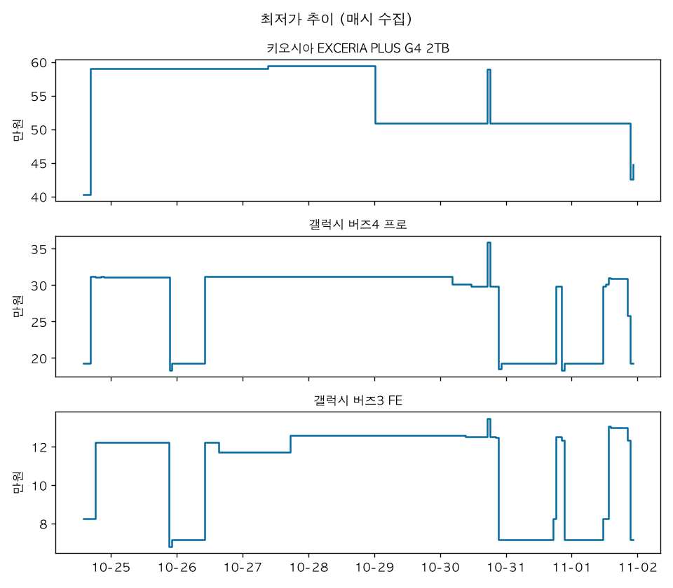
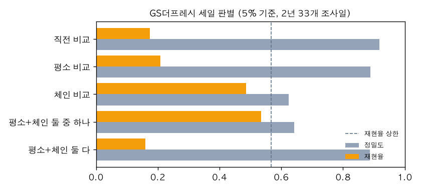

# 가격 데이터 분석: 무엇을 확인했고 제품에 어떻게 썼나

FlowDeck은 온라인 셀러가 경쟁 판매처의 가격을 지켜보는 포털이다. 모은 가격을 화면에 그대로 띄우기 전에, 데이터가 실제로 어떻게 움직이는지와 우리가 내는 신호를 믿을 수 있는지를 먼저 확인했다. 이 문서는 그 확인 다섯 가지를 결과와 제품 반영 위주로 정리한 것이다.

## 쓴 데이터

| 데이터 | 기간과 양 | 쓴 이유 |
|---|---|---|
| 다나와 상품 20개, 판매처별 가격 | 2026-10-24 ~ 11-11, 매시 | 실제 온라인 가격 |
| 연습 쇼핑몰(직접 만든 가상 쇼핑몰) | 4주치, 매시 | 할인 규칙을 우리가 알아서 정답과 맞춰 볼 수 있음 |
| 한국소비자원 참가격 | 2년, 15개 매장, 약 18만 건 | 매장이 직접 표시한 세일 여부가 있음 |
| 통계청 소비자물가 품목 지수 | 2년 | 공식 통계와 비교 |
| 공개 벤치마크, 논문 원자료 | | 우리 계산 방법 점검 |

## 1. 온라인 가격은 얼마나 자주, 얼마나 크게 바뀌나

- 다나와 상품 20개의 최저가는 한 시간에 10.7% 꼴로 바뀌었다. 그중 절반 이상이 10원 단위 경쟁이었고, 5% 넘게 바뀐 경우는 2.2%였다.
- 큰 하락의 85%는 저녁 6~9시에 생겼다. 판매처가 바뀐 것보다 같은 쇼핑몰 안의 가격 변화가 많았고, 몇 시간짜리 특가로 보였다.
- 최저가 하나만 보면 몇 시간짜리 특가가 시세 변화처럼 보였다.

제품 반영: 10원 단위 경쟁에는 알림을 보내지 않는다. 일정 폭 이상 바뀌고 일정 시간 이어진 변화만 알린다.

근거: [AN-0001](../analysis/0001-danawa-first-week.md)

## 2. 급락 알림 기준은 어떻게 정했나

- "5% 이상 바뀌고 2시간 이상 이어짐"을 기준으로 했다. 다나와에서 상품당 일주일에 3건 안팎이 잡혔다. 한 시간 만에 원래대로 돌아온 급등락은 걸렀다.
- 감지 코드는 정답을 아는 연습 쇼핑몰 데이터와 공개된 변화 감지 벤치마크로 먼저 점검했다. 벤치마크의 공개 점수를 우리 코드로 똑같이 재현해, 채점 방식이 맞는지부터 확인했다.

제품 반영: 상품 화면에 이 기준으로 잡힌 최저가 변화 목록과 차트 표시를 넣었다.

근거: [AN-0002](../analysis/0002-change-point-validation.md)

## 3. 가격만 보고 "지금 할인 중"인지 알 수 있나

매장이 직접 세일 표시를 붙이는 참가격 데이터로 확인했다. 대형마트 GS더프레시의 2년치 세일 표시를 정답으로 놓고, 가격만 보고 얼마나 맞히는지 쟀다.

- 그 매장의 지난 가격과 비교하면 세일의 5분의 1 정도만 찾았다. 세일이 보통 3주씩 가고 절반 넘게 바로 다음 세일로 이어져서, 평소 가격 자체가 세일 가격이 되기 때문이다.
- 같은 날 다른 마트 가격과 비교하면 절반 정도를 찾았다.
- 세일 표시가 붙은 가격의 39%는 평소 가격과 같거나 더 비쌌다. 가격만으로는 원래 구분할 수 없는 세일이다.

제품 반영: 할인 여부는 다른 판매처 가격과 비교한 위치를 주 기준으로 본다. 화면에는 "할인 중" 대신 "다른 곳보다 쌈", "평소보다 쌈"이라고 쓰고, 가격만 보고 "할인 아님"이라고 단정하지 않는다.

근거: [AN-0003](../analysis/0003-store-prices-and-discounts.md), [AN-0004](../analysis/0004-price-history-and-benchmarks.md)

## 4. 모은 가격이 공식 물가 통계와 같은 방향으로 움직이나

- 참가격으로 품목별 물가 지수를 만들어 통계청 지수와 2년치를 비교했다(81개 품목). 오르내린 방향은 4개 중 3개 품목에서 같았다.
- 라면, 세제 같은 가공·생활용품은 차이가 3.7%p 정도로 가까웠고, 채소·생선 같은 신선식품은 14.0%p로 컸다. 달 단위로는 거의 맞지 않았다.
- 온라인과 매장 가격을 비교한 유명 논문(Cavallo, 2017)의 원자료로 핵심 표를 다시 계산해, "온라인과 매장 가격이 72% 같다"는 결과를 그대로 얻었다. 우리 계산 방식이 연구에서 쓰는 정의와 같다는 확인이다.

제품 반영: 정부 통계를 대신하는 "시장 물가 지수" 기능은 만들지 않았다. 큰 방향은 맞지만 품목별 차이가 크다.

근거: [AN-0004](../analysis/0004-price-history-and-benchmarks.md)

## 5. 포털에 넣은 신호를 직접 돌려 보니

- 연습 쇼핑몰에서는 "평소보다 쌈"이 할인을 모두 맞혔다. 반면 "다른 곳보다 쌈"은 원래 가격이 싼 판매처에도 할인 없이 붙었다. 이 표시는 "싸다"는 뜻일 뿐 "할인 중"이라는 뜻이 아니다.
- 다나와에 돌려 보니 현금가 판매처의 80%에 "다른 곳보다 쌈"이 붙었다. 현금가는 카드가와 기준이 달라 늘 싸게 나온다. 현금가는 다른 판매처 비교에서 빼도록 고쳤다.

근거: [AN-0005](../analysis/0005-portal-price-signals.md)

## 아직 확인하지 못한 것

- 다나와 결과에는 사람이 표시한 정답이 없다. 급락 감지는 사례 몇 개만 판매처 목록과 대조했고, 할인 신호가 붙은 판매처가 실제로 할인 중인지는 확인하지 않았다.
- 다나와가 2026-11-11 저녁부터 수집 요청을 차단해서 그 뒤로 다나와 수집을 멈췄다. 차단 응답을 받으면 우회하지 않고 멈춘다는 수집 원칙을 따랐다([TS-0007](../troubleshooting/0007-danawa-403-blocked.md)). 다나와 데이터는 10-24부터 11-11까지 약 18일치다.
