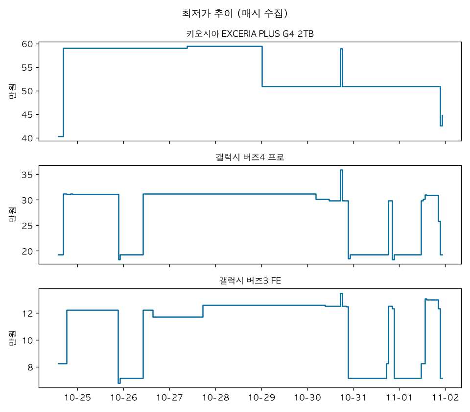
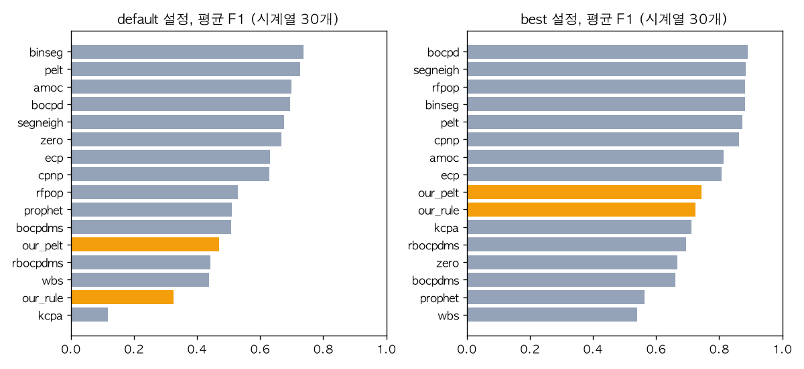
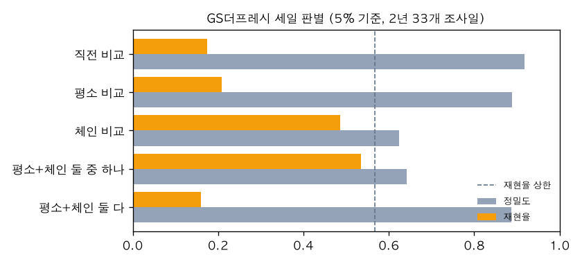
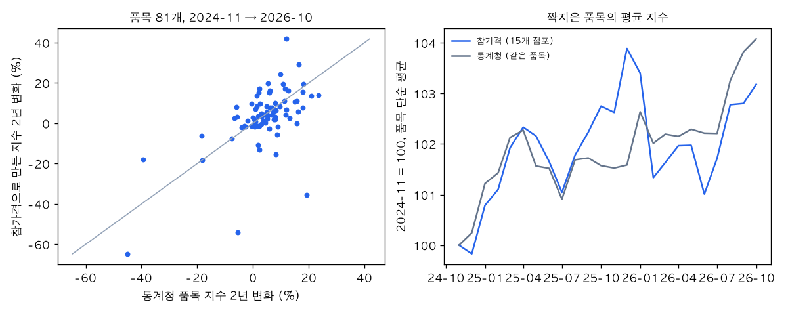

# 가격 데이터 분석: 방법, 검증, 틀렸던 판단

FlowDeck(경쟁사 가격 모니터링 포털)에서 가격 신호를 만들기 전에 한 분석 다섯 개를 정리한 문서다. 의뢰인용 요약은 [analysis-for-clients.md](analysis-for-clients.md). 각 항목의 원문은 분석 노트(AN)에 있고, 코드는 `analysis/`에 있다.

## 진행 방식

- 질문 하나에 분석 노트 하나를 썼다. 노트는 질문, 데이터, 시도 순서, 결과, 한계, 제품 반영으로 나눴고, 틀렸던 판단도 지우지 않고 남겼다.
- 우리 데이터(다나와)에는 정답이 없어서, 정답이 있는 데이터로 방법부터 점검했다. 직접 만든 연습 쇼핑몰(가격 규칙을 알고 있음), 매장이 세일을 표시하는 참가격, 공개 벤치마크와 논문 원자료를 썼다.
- 지표와 계산 정의는 공개된 숫자를 재현해서 확인한 뒤에 썼다.
- 원자료(다나와 수집 데이터, 참가격 응답, 논문 자료)는 저장소에 넣지 않았다.

## 데이터

| 데이터 | 범위 | 노트 |
|---|---|---|
| 다나와 상품 20개 | 2026-10-24 ~ 11-11 매시, 최저가·판매처 수·상위 판매처 | AN-0001, 0002, 0003, 0005 |
| 연습 쇼핑몰 | 4주 매시, 판매처별 가격과 적용된 규칙(주말 할인, 급락 특가, 품절) | AN-0002, 0005 |
| TCPD, TCPDBench | 단변량 시계열 30개, 공개 알고리즘 14개의 점수 | AN-0002 |
| 참가격 | 파일 2개 조사일 235,632행(AN-0003), Open API 15개 점포 x 46개 조사일 179,936행(AN-0004) | AN-0003, 0004 |
| 통계청 품목 지수 | 2024-10 ~ 2026-10, 전국 | AN-0004 |
| Cavallo(2017) 복제 자료 | 원자료 45,253행 | AN-0004 |

## AN-0001 다나와 1주 가격 변동

- 최저가는 시간당 10.7% 바뀌었고, 절반 이상이 10원 단위였다. 5% 이상 변화는 88건(2.2%)이고, 큰 하락의 85%가 18~21시였다.
- 상품을 고를 때 세운 가정("판매처가 많으면 가격이 자주 움직인다")은 맞지 않았다(스피어먼 0.16).
- 틀렸던 판단: 앞서 devlog에 키오시아 SSD 최저가를 "46% 상승"으로 적었다. 판매처 목록을 같이 보니 몇 시간짜리 특가가 끝난 것이었다.
- 집계를 보다가 배송비 33,000원이 1주 동안 수천 행 저장된 것을 발견했다. "빠른배송" 안내 숫자가 배송비에 섞이는 파서 버그였고, 파싱 실패만 세던 감시 기준으로는 잡히지 않았다(#33에서 수정).

## AN-0002 급락·변화 감지 검증

- 지표부터 확인했다. TCPDBench에 저장된 점수 545개를 우리 F1·cover 구현으로 다시 계산해 모두 같게 만들었다. 이 과정에서 탐욕적 짝짓기 F1이 순서에 따라 결과가 달라질 수 있다는 것을 알았다.
- 연습 쇼핑몰에서 규칙 감지기(직전 수준 대비 5% 이상, 2번 연속)는 넣은 급락을 거의 다 찾았다(F1 0.992). 다만 규칙을 알고 기준을 고른 결과라 기준의 근거로는 쓰지 않았다.
- TCPD에서는 정해 둔 설정의 우리 감지기 둘 다 "변화점 없음"만 답하는 기준선(F1 0.668)보다 낮았다. 계단형 가격용 규칙을 일반 변화점 감지기처럼 소개하면 안 된다는 결론이었다.
- 우리 PELT(0.471)와 R 구현(0.728)의 차이는 벌점이었다. 1차 차분의 MAD로 잡음을 추정하면 계단형 시계열에서 0으로 무너진다. 벌점을 MBIC로 바꾸자 0.725가 됐다. 그래도 알림에는 쓰지 않았다. 상품마다 변동폭에 따라 기준이 달라져서 "5% 넘게 바뀌면 알림"과 맞지 않는다.
- 다나와에서 규칙(5%, 2시간)은 1주 59건, 상품당 주 3건 안팎이었다.

## AN-0003, AN-0004 가격만으로 할인을 판별할 수 있나

- AN-0003(조사일 이틀): 대형 체인은 같은 날 점포 98% 이상이 같은 가격이라, 경쟁 가격은 체인 단위로 보면 된다. 다른 체인과 비교하는 판별이 F1 0.62~0.70으로 가장 나았다.
- AN-0004(2년): GS더프레시 5% 기준 재현율은 직전 비교 0.174, 평소 가격(직전 6개 조사일 중앙값) 비교 0.208, 다른 체인 비교 0.487, 둘 중 하나 0.535였다. 세일은 중앙값 21일이고 다음 세일까지 중앙값 1일이라, 평소 가격이 세일 가격이 된다. 세일 가격의 39%는 평소 가격 이상이어서 가격만 쓰는 방법의 재현율 상한이 0.567이다.
- 틀렸던 판단: 이틀 데이터의 체인 비교 F1(0.62~0.70)이 2년(0.55~0.57)보다 높았다. 정답 처리와 비교 대상 정의가 달라 같은 조건의 비교는 아니지만, 짧은 기간 결과로 기준값을 정하면 안 된다는 것은 확인했다.
- API 명세의 조사일("매주 금요일")이 실제(대체로 2주 간격, 공휴일 주는 빔)와 달랐다. 한 상품으로 금요일 105개를 먼저 찍어 조사일 46개를 찾고 그 날짜만 받아서, 하루 호출 한도(2,000) 안인 811건으로 끝냈다.

## AN-0004 공식 통계와 논문 재현

- 참가격으로 만든 Jevons 품목 지수는 통계청 품목 지수와 2년 변화 방향이 75.3% 같았고 상관 0.585였다. 가공품은 차이 중앙값 3.7%p, 신선식품 14.0%p, 월별 상관 중앙값 0.24다.
- Cavallo(2017) 표 3은 표본 조건(세일 포함 여부, 대체 입력값) 네 가지를 다 계산해 관측 수 38,383이 맞는 조합을 먼저 찾았다. 그 뒤로 11개 행 33칸이 반올림 기준 모두 같았다(같은 가격 71.5%, 논문 72%). 표 5, 6은 전체 관측 14,368(논문 14,367), 동시 변경 18.6%(19%)이고 나라별로 몇 건 차이가 났다.

## AN-0005 포털 신호 구현 확인

- 신호 규칙은 DB를 모르는 함수(`backend/src/flowdeck/signals.py`)로 두고, API가 요청 때 수집 기록에서 계산한다. 기준이 아직 바뀌는 중이라 결과를 저장하지 않았다([ADR-0014](../adr/0014-price-signals-on-request.md)).
- 분석 코드가 이 함수를 그대로 불러 검증했다. 포털의 최저가 변화는 분석 코드의 규칙과 204개 변화점 위치가 모두 같았다.
- 연습 쇼핑몰: "평소보다 쌈" 정밀도·재현율 1.000(규칙의 할인 폭 10%, 25%와 변동폭 ±3% 때문), "다른 곳보다 쌈" 정밀도 0.520·재현율 0.671. 오탐은 기본가가 다른 판매처보다 3.3~5.8% 낮은 네 판매처에 몰렸다. AN-0004와 달리 자기 가격 비교가 나았던 것은 할인이 짧고 띄엄띄엄 있어서다.
- 틀렸던 구현: 처음에는 현금가를 기준값에서만 빼고 현금가 판매처 자신의 비교 값은 냈다. 다나와에 돌려 보니 현금가 판매처의 80.5%에 "다른 곳보다 쌈"이 붙어서, 현금가는 비교 값을 내지 않게 고쳤다.

## 한계

- 다나와에는 사람이 표시한 정답이 없다. 연습 쇼핑몰 정답은 우리가 만든 규칙이라 기준값의 근거가 되지 않는다.
- 다나와 데이터는 약 18일, 상품 20개, 판매처는 쇼핑몰 단위다. 2026-11-11 저녁부터 다나와가 수집기에 403을 돌려줘 수집을 멈췄다([TS-0007](../troubleshooting/0007-danawa-403-blocked.md)).
- 참가격은 오프라인 매장 중심이라 온라인 오픈마켓과 가격을 정하는 방식이 다를 수 있다.

## 원문

[AN-0001](../analysis/0001-danawa-first-week.md), [AN-0002](../analysis/0002-change-point-validation.md), [AN-0003](../analysis/0003-store-prices-and-discounts.md), [AN-0004](../analysis/0004-price-history-and-benchmarks.md), [AN-0005](../analysis/0005-portal-price-signals.md), [ADR-0014](../adr/0014-price-signals-on-request.md)
